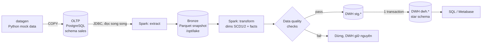
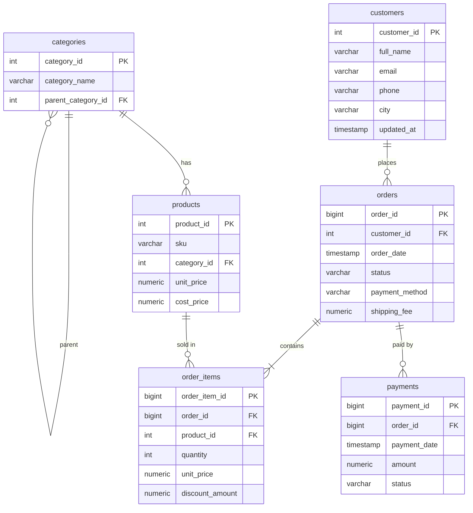
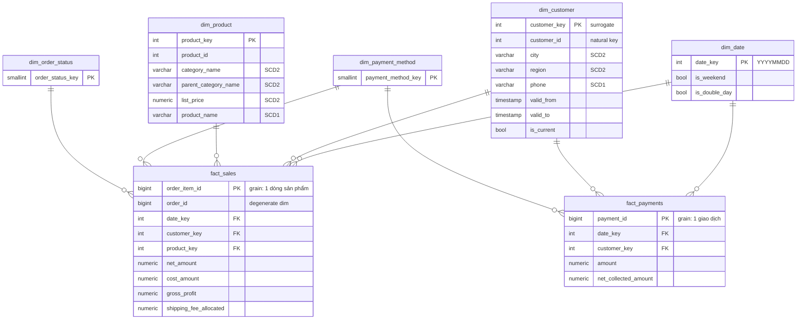

# Data Modeling: OLTP → OLAP với Spark

Dự án mẫu về **mô hình hóa dữ liệu** cho nghiệp vụ bán hàng online. Dữ liệu đi từ một
cơ sở dữ liệu giao dịch (OLTP, chuẩn hóa 3NF) sang một kho dữ liệu phân tích (OLAP, star
schema theo Kimball) qua một pipeline **PySpark**. Mọi thành phần chạy bằng **Docker Compose**.

Những gì dự án minh họa:

- Thiết kế OLTP 6 bảng: `categories`, `customers`, `products`, `orders`, `order_items`, `payments`
- Thiết kế OLAP: 5 dimension và 2 fact dùng chung dimension (fact constellation)
- **SCD Type 2 + Type 1** (lưu lịch sử khi khách chuyển nhà, sản phẩm đổi giá hoặc đổi danh mục)
- Tra cứu khóa **point-in-time**: mỗi fact trỏ tới phiên bản dimension có hiệu lực lúc giao dịch xảy ra
- Làm sạch và chuẩn hóa dữ liệu (tên thành phố, số điện thoại, email), phẳng hóa cây danh mục (snowflake → star)
- Phân bổ phí ship từ cấp đơn hàng xuống cấp dòng sản phẩm
- **Data quality gate**: đối soát số liệu với nguồn trước khi publish
- Publish **nguyên tử** (stg → dwh trong 1 transaction) và ghi nhật ký audit cho mỗi lần chạy
- Bộ truy vấn phân tích mẫu: ROLLUP, window function, RFM, so sánh as-was và as-is

## Kiến trúc



| Thành phần | Công nghệ | Cổng trên host |
|---|---|---|
| OLTP database | PostgreSQL 16 (`oltp-db`) | `5433` |
| Data warehouse | PostgreSQL 16 (`dwh-db`) | `5434` |
| Xử lý ETL | Apache Spark 3.5.8 standalone (1 master + 1 worker), PySpark | UI `8080`, `8081`, job `4040` |
| Data lake (bronze) | Parquet trên Docker volume `lake` | — |
| Sinh dữ liệu | Python 3.12 + psycopg2 | — |
| BI (tùy chọn) | Metabase | `3000` |

## Chạy nhanh

Yêu cầu: Docker + Docker Compose v2, `make`, khoảng 3 GB RAM trống.

```bash
make up        # build image, khởi động PostgreSQL x2 + Spark cluster
make seed      # sinh dữ liệu mock vào OLTP (5.000 khách, 400 sản phẩm, 60.000 đơn từ 01/2024)
make etl       # chạy pipeline OLTP -> OLAP (khoảng 30 giây)
make analytics # chạy các truy vấn phân tích mẫu trên DWH
```

Hoặc chạy gộp `make all` (gồm up, seed và etl). Gõ `make` để xem toàn bộ lệnh.

### Demo SCD Type 2 (load lần 2)

```bash
make simulate  # mô phỏng 1 ngày kinh doanh: đơn mới, 40 khách chuyển nhà, 30 khách đổi SĐT,
               # 25 sản phẩm đổi giá, tách danh mục "Gaming Gear", 80 khách mới
make etl       # load lại: chỉ khách/sản phẩm thay đổi mới sinh version mới
make scd-demo  # xem lịch sử version và fact trỏ đúng version theo thời điểm mua
```

Log của lần chạy thứ hai có dạng như dưới đây. Con số cụ thể thay đổi giữa các lần chạy vì simulate chọn khách và sản phẩm ngẫu nhiên.

```
dim_customer SCD2: {'mode': 'incremental', 'new_keys': 80, 'changed_keys': 40}   <- 30 khách đổi SĐT không sinh version (Type 1)
dim_product  SCD2: {'mode': 'incremental', 'new_keys': 0,  'changed_keys': 37}   <- đổi giá + chuyển sang "Gaming Gear"
DQ PASS fact_sales rows = OLTP order_items       115920 vs 115920
DQ PASS fact_sales net_amount = OLTP             ...
```

### Kết nối trực tiếp

| | Host | Port | Database | User / Password |
|---|---|---|---|---|
| OLTP | localhost | 5433 | `shop_oltp` (schema `sales`) | `oltp` / `oltp` |
| DWH | localhost | 5434 | `shop_dwh` (schema `dwh`, `stg`, `audit`) | `dwh` / `dwh` |

Có thể mở psql bằng `make psql-oltp` hoặc `make psql-dwh`. Muốn dùng Metabase thì chạy `make bi`, mở
http://localhost:3000 rồi thêm database PostgreSQL với host `dwh-db`, port `5432`.

## Mô hình dữ liệu

Chi tiết về từng cột, quyết định thiết kế và bảng ánh xạ nguồn → đích nằm trong
[docs/data-model.md](docs/data-model.md).

### OLTP: chuẩn hóa 3NF, tối ưu cho ghi giao dịch



### OLAP: star schema, tối ưu cho đọc và tổng hợp



### OLTP và OLAP trên cùng một câu hỏi

*"Doanh thu năm 2025 theo miền và danh mục cha"*

| | OLTP (`sales`) | OLAP (`dwh`) |
|---|---|---|
| Join | 6 bảng, có self-join `categories` để lấy danh mục cha | 1 fact + 4 dimension, mọi join đều theo khóa nguyên |
| Vùng miền | Phải tự viết `CASE` và tự xử lý tên bẩn (`HN`, `Ha Noi`, `hà nội`…) | Cột `region` đã chuẩn hóa sẵn |
| Lịch sử | Chỉ biết địa chỉ **hiện tại** của khách | Biết địa chỉ **tại thời điểm mua** (SCD2) |
| Kết quả | Lệch khỏi OLAP ngay khi có khách chuyển nhà, hoặc khi danh sách tên bẩn trong `CASE` bị thiếu | Ổn định, tái lập được |

## Pipeline ETL

Code nằm trong [spark/jobs/](spark/jobs/), entrypoint là [main.py](spark/jobs/main.py):

| Bước | Module | Mô tả |
|---|---|---|
| Extract | [extract.py](spark/jobs/etl/extract.py) | Đọc 6 bảng qua JDBC (bảng lớn chia 4 partition theo khóa chính) rồi ghi snapshot Parquet `bronze/<table>/extract_date=YYYY-MM-DD` |
| Dimensions | [dimensions.py](spark/jobs/etl/dimensions.py) | Làm sạch, chuẩn hóa thành phố → vùng miền, phẳng hóa danh mục cha/con, phân khúc giá, sinh `dim_date`, thêm unknown member `-1` |
| SCD | [scd.py](spark/jobs/etl/scd.py) | Merge SCD2 tổng quát: so sánh hash các cột Type 2, đóng version cũ (`valid_to`), mở version mới; cột Type 1 ghi đè trên mọi version |
| Facts | [facts.py](spark/jobs/etl/facts.py) | Tra cứu khóa point-in-time `valid_from <= event_ts < valid_to`, tính measure, phân bổ phí ship (phần dư làm tròn dồn vào dòng cuối) |
| Quality | [quality.py](spark/jobs/etl/quality.py) | 17 phép kiểm: đối soát số dòng và tổng tiền với nguồn, không có khóa unknown, mỗi key chỉ có 1 version hiện hành, dim_date phủ hết fact… |
| Load | [load.py](spark/jobs/etl/load.py) | Ghi `stg.*`, sau đó `TRUNCATE` + `INSERT` vào `dwh.*` trong **một transaction**, rồi ghi `audit.etl_run_log` |

Pipeline có tính **idempotent**: chạy lại khi nguồn không đổi thì không sinh version mới và số
dòng giữ nguyên. Nếu chỉ muốn chạy lại phần transform/load mà không đọc lại OLTP, dùng `make etl-rerun`.

## Cấu trúc thư mục

```
.
├── docker-compose.yml        # oltp-db, dwh-db, spark-master, spark-worker, datagen, metabase
├── Makefile                  # các lệnh tắt
├── .env.example              # cổng, mật khẩu, khối lượng dữ liệu mock
├── oltp/init/01_schema.sql   # DDL OLTP (schema sales)
├── dwh/init/01_schema.sql    # DDL kho dữ liệu (schema stg, dwh, audit)
├── datagen/                  # sinh dữ liệu mock + mô phỏng thay đổi
│   ├── generate_data.py
│   ├── simulate_changes.py
│   └── reference.py          # tên, thành phố, cây danh mục, thương hiệu VN
├── spark/
│   ├── Dockerfile            # spark:3.5.8 + PostgreSQL JDBC + psycopg2
│   ├── conf/                 # spark-defaults (timezone, memory), log4j2
│   ├── submit.sh             # đóng gói package etl và chạy spark-submit
│   └── jobs/                 # main.py + package etl/
├── sql/
│   ├── analytics.sql         # 11 truy vấn phân tích mẫu
│   └── scd2_demo.sql         # minh họa SCD2
└── docs/data-model.md        # tài liệu thiết kế chi tiết
```

## Tùy chỉnh

Sao chép `.env.example` thành `.env` rồi sửa: cổng host (khi bị trùng), RAM/CPU cho Spark worker,
khối lượng dữ liệu (`N_CUSTOMERS`, `N_ORDERS`, `START_DATE`). Sau khi đổi khối lượng dữ liệu, chạy
`make seed && make reset-dwh && make etl`.

> Đã seed lại OLTP thì phải chạy `make reset-dwh`, vì id trong OLTP mới không còn khớp với lịch sử SCD2 cũ trong kho.

| Lệnh | Tác dụng |
|---|---|
| `make reset-dwh` | Xóa kho dữ liệu và bronze, giữ OLTP |
| `make down` | Dừng container, giữ dữ liệu |
| `make clean` | Dừng và xóa **toàn bộ** volume |

## Hướng mở rộng

- **Điều phối**: thêm Apache Airflow (DAG gồm `extract >> transform >> quality >> publish`, lập lịch hằng ngày)
- **Incremental fact load**: dùng watermark `updated_at` và `MERGE` thay vì ghi lại toàn bộ fact
- **Lakehouse**: lưu bronze/silver/gold bằng Delta Lake hoặc Apache Iceberg trên MinIO (S3)
- **OLAP engine cột**: đổi DWH sang ClickHouse hoặc DuckDB để so sánh hiệu năng tổng hợp
- **dbt**: chuyển phần transform SQL-friendly sang dbt models và dbt tests
- **Dữ liệu thật**: thay datagen bằng bộ [Brazilian E-Commerce (Olist)](https://www.kaggle.com/datasets/olistbr/brazilian-ecommerce) trên Kaggle, có cấu trúc tương tự
